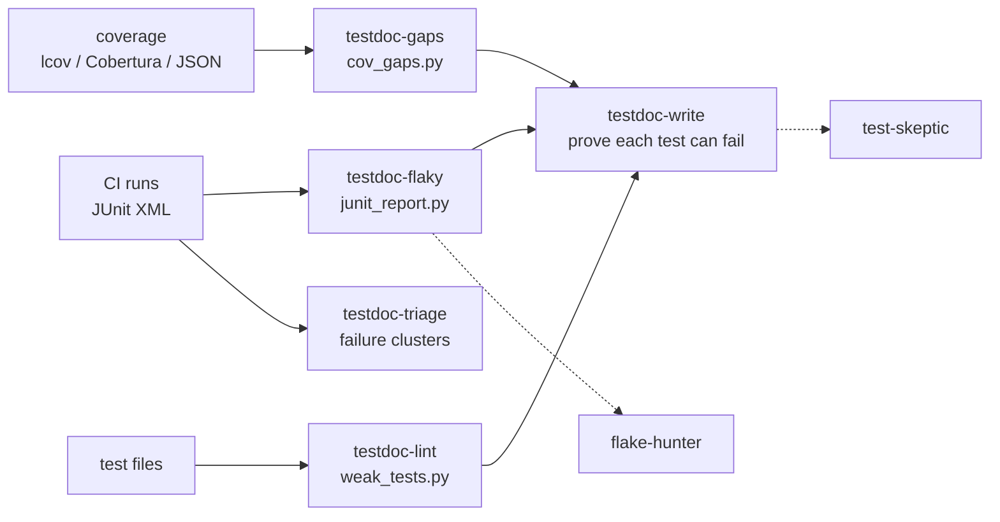

# test-doctor-skill

**Your tests lie. Find out which ones.**


The suite is green, and a bug shipped anyway. Or the suite is red every third run and everyone
has learned to click "re-run". Or coverage says 70% and nobody can say which 30% matters. The
evidence for all three is already sitting in your CI: JUnit XML from every run, a coverage file,
and the test code itself.

This Claude Code pack reads those artifacts. It ranks the tests that pass and fail on the same
code, lists what is untested in the order you should test it, and finds tests that cannot fail
because they assert nothing. Each skill ends with a fix: the smallest change for the cause it
found, never a blanket retry, and every new test is shown to fail when the code is wrong.

Everything runs locally with the Python standard library. The output is deterministic, so the
same inputs give the same report.

## What's inside

| Skill | What it does |
|---|---|
| [`testdoc-flaky`](skills/testdoc-flaky/SKILL.md) | `junit_report.py`: reads several CI runs of JUnit XML (pytest, Jest, Surefire, gotestsum), ranks flaky tests by flake rate, lists slow tests and failure clusters. Guides the fix per cause: timing, shared state, network, randomness, time zone, resources. |
| [`testdoc-gaps`](skills/testdoc-gaps/SKILL.md) | `cov_gaps.py`: reads lcov, Cobertura or coverage.py JSON and prints "where to write tests first": uncovered ranges, branches never taken, functions never called, optionally only files changed since a git ref. |
| [`testdoc-lint`](skills/testdoc-lint/SKILL.md) | `weak_tests.py`: ten rules (WT001 to WT010) for tests that cannot fail or hide failures, in Python, JS/TS, Go and Java. Then fixes them and proves each fix can fail. |
| [`testdoc-write`](skills/testdoc-write/SKILL.md) | A procedure for characterization and regression tests: enumerate behaviours, name them, break the code on purpose to see each test go red, keep tests independent of order and clock. |
| [`testdoc-triage`](skills/testdoc-triage/SKILL.md) | Groups a red CI run's failures by root cause, decides product bug, test bug, environment or flaky, and gives one next action per cluster. |

| Agent | What it does |
|---|---|
| [`flake-hunter`](agents/flake-hunter.md) | Reads the report and the code, returns ranked flaky suspects with file and line evidence and a way to prove each diagnosis. |
| [`test-skeptic`](agents/test-skeptic.md) | Reviews new tests and answers "would this test fail if the code were wrong?" per test, naming the mutation that slips through. |

## Install

```
/plugin marketplace add vivekbhange-hub/test-doctor-skill
/plugin install test-doctor-skill@test-doctor-skill
```

Manual install: copy `skills/*` into `~/.claude/skills/` and `agents/*` into `~/.claude/agents/`.

Requirements: Python 3.9 or newer. Nothing else. `git` is needed only for `--changed-since`.

## Try it in 60 seconds

The repo ships a fictional shop test suite as fixtures: five JUnit runs of the same suite in
[`examples/junit/`](examples/junit/), an [`lcov.info`](examples/coverage/lcov.info), and a few
deliberately weak tests in [`examples/weak/`](examples/weak/). In Claude Code:

> Find the flaky tests in examples/junit, then tell me where to write tests first

Or run the scripts yourself from the repo root (on Windows use `python` instead of `python3`):

```bash
python3 skills/testdoc-flaky/junit_report.py examples/junit
python3 skills/testdoc-gaps/cov_gaps.py examples/coverage/lcov.info
python3 skills/testdoc-lint/weak_tests.py examples/weak
```

Example output, copied from the committed files in [`examples/output/`](examples/output/).

**Flaky tests.** Six of the 24 tests passed and failed on the same code. The report guesses a
cause from the failure text. The guess is a place to start reading, and one test honestly says
"unknown":

```text
5 run(s), 24 distinct tests, 115 executions. 6 flaky, 2 consistently failing.

| Test | Pass | Fail | Flake rate | Failed in | Likely cause |
|---|---:|---:|---:|---|---|
| `tests.test_inventory.TestInventory::test_reserve_stock` | 2 | 3 | 60% | run1.xml, run3.xml, run4.xml | ordering/shared state |
| `tests.test_api.TestPricingApi::test_fetch_exchange_rate` | 3 | 2 | 40% | run2.xml, run3.xml | network |
| `tests.test_checkout.TestCheckout::test_order_confirmation_email` | 3 | 2 | 40% | run2.xml, run5.xml | timing |
| `tests.test_inventory.TestInventory::test_release_stock` | 3 | 2 | 40% | run3.xml, run4.xml | ordering/shared state |
| `tests.test_recommendations.TestRecommender::test_top_pick_is_stable` | 4 | 1 | 20% | run3.xml | unknown |
| `tests.test_reports.TestDailyReport::test_report_covers_today` | 4 | 1 | 20% | run4.xml | time-zone/date |
```

Two tests fail in every run, so they are bugs and not flakes:

```text
| Test | Runs | Sample message |
|---|---:|---|
| `tests.test_cart.TestCart::test_apply_coupon_expired` | 5 | AssertionError: assert Decimal('9.99') == Decimal('10.00') |
| `tests.test_shipping.TestShipping::test_zone_lookup` | 5 | KeyError: 'ZZ' |
```

Failure clusters group messages after stripping numbers, ids, addresses and paths. The row ids in
the two `reservations.sku` failures differ, so they land in one cluster:

```text
| # | Count | Tests | Pattern | Sample |
|---:|---:|---:|---|---|
| 1 | 5 | 1 | `AssertionError: assert Decimal('N') == Decimal('N')` | AssertionError: assert Decimal('9.99') == Decimal('10.00') |
| 2 | 5 | 1 | `KeyError: 'ZZ'` | KeyError: 'ZZ' |
| 3 | 5 | 2 | `sqlite3.IntegrityError: UNIQUE constraint failed: reservations.sku (row N)` | sqlite3.IntegrityError: UNIQUE constraint failed: reservations.sku (row 17) |
| 4 | 2 | 1 | `TimeoutError: timed out after Ns waiting for mailbox to receive N message` | TimeoutError: timed out after 5.0s waiting for mailbox to receive 1 message |
```

**Where to write tests first.**

```text
Lines: 372/522 covered (71.3%). Branches: 33/41 covered (80.5%). Files with gaps: 6 of 7.

| # | File | Line coverage | Uncovered lines | Branches missed | Functions never called | Priority |
|---:|---|---:|---:|---:|---:|---:|
| 1 | `src/shop/checkout.py` | 54.9% | 69 | 4 | 1 | 31.1 |
| 2 | `src/shop/reports.py` | 67.6% | 33 | 1 | 1 | 10.7 |
| 3 | `src/shop/shipping.py` | 64.7% | 18 | 1 | 1 | 6.4 |
```

The details for the top file:

```text
- Uncovered lines: 41-47, 78-90, 92-139, 160-171
- Branches never taken: 45 (2/2 untaken), 76 (2/3 untaken)
- Functions never called: `refund` (line 92)
- Largest untested block: lines 92-139 (42 uncovered, inside `refund`)
```

**Tests that cannot fail.**

```text
Scanned 4 test file(s) and 43 tests. 40 finding(s): 21 high, 13 medium, 6 low.

| Rule | Severity | Count | Meaning |
|---|---|---:|---|
| WT001 | high | 8 | No assertion |
| WT002 | high | 4 | Assertion that cannot fail |
| WT003 | medium | 4 | Only a not-None / defined check |
| WT004 | high | 4 | Empty test body |
```

```text
| `examples/weak/OrderServiceTest.java:14` | WT001 | high | `createsOrder` | no assertion; this test only fails if the code under test raises |
| `examples/weak/OrderServiceTest.java:20` | WT002 | high | `alwaysTrue` | assertion can never fail: assertTrue(true) |
| `examples/weak/OrderServiceTest.java:29` | WT004 | high | `cancelsLater` | empty test body |
| `examples/weak/test_orders.py:16` | WT002 | high | `TestOrders.test_cancel_order_returns` | assertion can never fail: self.assertTrue(True) |
```

`python examples/regenerate.py --check` proves the committed outputs are exactly what the scripts
produce today, and the test suite checks that every quoted line above appears in them.

## How it works



1. **Read what CI already has.** `junit_report.py` treats each XML file as one run. A test that
   both passed and failed across runs is flaky; one that failed every time is a bug. Failure
   messages are normalised and grouped. `cov_gaps.py` ranks files by uncovered lines times the
   share of the file that is uncovered. `weak_tests.py` parses Python with `ast` and uses
   bracket matching for JS/TS, Go and Java.
2. **Name the cause, then fix the cause.** Each skill maps a symptom to its smallest fix:
   wait on a condition instead of sleeping, give each test its own data, stub the network, seed
   the random generator, inject the clock.
3. **Prove the fix.** `testdoc-write` breaks the code on purpose and checks the new test goes
   red, then restores it. `test-skeptic` asks the same question for every test in a diff.

Outputs go to `testdoc/` in your project: `flaky-report.md`, `coverage-gaps.md`, `weak-tests.md`
and `triage.md`.

## Responsible use

Run this on repositories and CI systems you own or are authorized to use.

- Downloading CI artifacts with `gh` needs permission on that repository, and logs can contain
  secrets. The skills summarize failures instead of pasting logs.
- The scripts only read files. The one command they can run is `git diff --name-only`, and only
  when you pass `--changed-since`. Nothing is uploaded anywhere.
- Do not use the reports to rank or blame people. They describe tests, not authors.

## Principles and limits

- **Evidence over opinion.** A cause is named only with a line of failure text or code behind
  it. The keyword hint in the report is a hint, and the skills say so.
- **No blanket retries.** Retrying hides the signal. The skills fix the cause or quarantine a
  test with a reason and a ticket.
- **Flakiness needs several runs of the same code.** One run shows nothing; runs on different
  commits can mix real regressions with flakes. A flake rate above about 80% usually means a
  regression.
- **Coverage measures execution, not checking.** A test that runs a line without asserting
  raises the number and proves nothing; that is why `testdoc-lint` exists.
- **The lint has edges.** Python is parsed exactly. JS/TS, Go and Java are matched with
  patterns, so unusual code can be missed or occasionally flagged by mistake. Suppress a finding
  with a comment containing `testdoc: ignore WT007` on the line or the line above it.
- **Helper functions count as assertions.** In Python, a helper defined in the same file that
  asserts is followed. In every language, a call to something named `assert*`, `check*`,
  `verify*`, `validate*` or `expect*` is treated as an assertion even if it does not assert.
- **Nothing leaves your machine.** No telemetry, no third-party packages.

## Contributing

See [CONTRIBUTING.md](CONTRIBUTING.md). Run the tests with
`python -m unittest discover -s tests -v`.

## License

MIT (c) 2026 Vivek Bhange. See [LICENSE](LICENSE).
